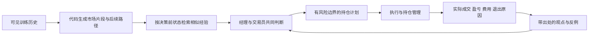

# 从历史经验到共同判断与持仓

采用现有经理＋交易员，共享一套经验；按需要研究趋势、微观结构、风险和执行，不增加常驻付费 agent。经理负责综合和持仓授权，交易员负责具体研究。每份观点保留贡献者与证据，共用证据的多次赞同不算独立证据。

## 已接入的数据与经验

首次训练缓存有 **79,844 根分钟 K 线**，覆盖 2026-06-12 09:02 至 2026-08-07 10:16 UTC，资金费记录 1,346 条。它是已有开发训练数据，独立 60 天评估窗口没有打开。

按固定 UTC 四小时网格生成市场片段：用当时之前 1、4、8 小时收益和四小时实现波动描述状态；记录随后 4、8 小时的多空收益代理、手续费、资金费与有利/不利价格路径。严格要求前八小时、后八小时无缺口，332 个候选中得到 **71 个完整片段**，261 个因缺口剔除。这个筛选偏向数据完整的时期，不能把 71 个片段当成 79,844 个独立交易样本。

当前状态按四个预先固定的特征及历史尺度检索最多 20 个相似片段。检索排序不使用后续盈利；保留选中片段的所有输赢。资金费缺失时净代理结果为空，保留仅扣手续费结果，不补成零。八小时标签在四小时网格上重叠，案例数不等于独立样本数。

这些数据构成可检索经验，并没有训练 LLM 权重，也没有证明新的预测策略。邻近案例的均值、盈利次数和最大不利路径不是校准后的未来收益、胜率或风险保证。历史价格/资金费代理遗漏价差、冲击、排队及延迟；实际盈亏以办公室成交账本为准。

## 共同知识

- `GET /research/experience`：训练来源、当前状态、相似片段和双方向结果。
- `GET /knowledge`：带贡献者的观点，以及自动纳入的真实模拟平仓结果。
- `POST /knowledge`：追加观察、假设、实验、结果或勘误；不提供覆写/删除接口。

每条贡献包含 `topic`、`perspective`、`kind`、`claim`、`information_cutoff`、`evidence`、`parent_ids` 和 `limitations`。服务端写入贡献者和时间。未来信息截止时间、未知父记录或晚于截止时间的父证据被拒绝。自由文本引用仍需审查，agent 提交并不等于办公室核实。

观点的来源标为 `agent_submitted`；账本直接读取的平仓结果标为 `office_measured`。初始三笔实际亏损也在其中。自动纳入结果复用既有成交事件，不改变结算、不复制写入，不消耗模型。

## 访问与持久化

经理每次唤醒自动收到简短经验报告及最近共同知识。完整案例保存在其状态目录 `collective-experience.json`，可读表为 `collective-experience.md`。

经理也可用 `office experience`、`office knowledge`、`office remember FILE`。交易员重启后的原生工具包括 `historical_experience(detail=False)`、`collective_knowledge()`、`remember(entry)`；现有共享 REPL 已安装无状态 `collective_memory` 对象，其 experience/knowledge/remember 方法可立即使用。这次没有重启交易员、调用模型预热或改变策略版本。

大数据留在代码与存储中；模型默认看摘要和案例索引，按问题读取详细案例。共同知识存于办公室追加式事件账本，跨进程重启及人员更替保留。

## 持仓与反馈

计划要引用待检验的经验和假设，写明方向、金额风险、规模、失效条件、保护性退出及复核安排。判断有效时允许盈利发展；判断失效、风险触发或继续持有已不合算时减少/退出。复核时间不自动等于止盈时间，亏损后不放宽风险等待回本。执行代码和保护单在模型未唤醒时继续工作。

首次实操决策单独约束为：计划亏损含费用不超过 $0.50，名义仓位不超过账户净值；经理根据当前信息决定执行或说明具体等待条件，不启动新的付费交易员研究。

### 第一笔实际模拟实验

2026-10-13 **23:22:29 Budapest**，经理以 **83,280** 做多 **0.001 BTC**，仓位 #4，名义金额 $83.28。Mark 止损 **82,920**（订单 #8）与止盈 **84,045**（订单 #9）为 OCO、reduce-only 退出单。计划止损损失含两边手续费约 **$0.4431**，滑点可能使实际损失不同。最大持有四小时，至 2026-10-14 03:22:29 Budapest。

该决策用了当时一致为正的 1/4/8 小时路径和历史相似片段作为未证明的延续假设。经理完成一次 97.5 秒的订阅内决策，没有新增付费交易员任务。实验记录为共同知识 #3985，引用过去三笔办公室实测亏损及当前成交/退出订单。

执行核验发现旧 `should_wake` 仍指向仓位 #2。已保存旧监听器并接入新仓位的明确监控：到计划复核时间后每 15 分钟检查，若新鲜数据的四小时收益 <= -20 bps 且一小时收益 < 0，执行经理已批准的失效退出；缺失保护止损则尝试恢复，失败时请求平仓；到期退出。代码每分钟运行，夜间继续，模型仅在办公室时段接收必要通知。这个数值条件来自本次经理计划，不是新增优化的入场规则。

该监控会改变执行代码的策略版本，记入计划日志；此前单纯安装记忆对象没有改变版本。它不增加仓位、不放宽止损，也不代替保护订单。未来计划需明确批准监控配置。

## 验证

新增检查覆盖未来 K 线排除、训练边界、未知后续标签屏蔽、检索不依赖盈利、费用与资金费、缺口、观点归属、追加勘误、父证据时序，以及实际平仓自动读取。完整测试集 **113 项通过**。线上已验证 71 个历史片段、20 个相似案例、三笔真实模拟平仓记忆，以及共享 REPL 接入前后交易员轮次和策略版本保持不变。

随后新增的持仓监控另有 **4 项检查通过**，覆盖复核时机、趋势失效、陈旧数据、止损缺失、到期及未批准配置；线上确认新监听器读取当前仓位与真实保护订单。

[首份经验报表](examples/collective-experience-first.md) · [完整案例与来源](examples/collective-experience-first.json) · [计算代码](../agents/common/experience.py) · [共同知识服务](../server/knowledge.py)
