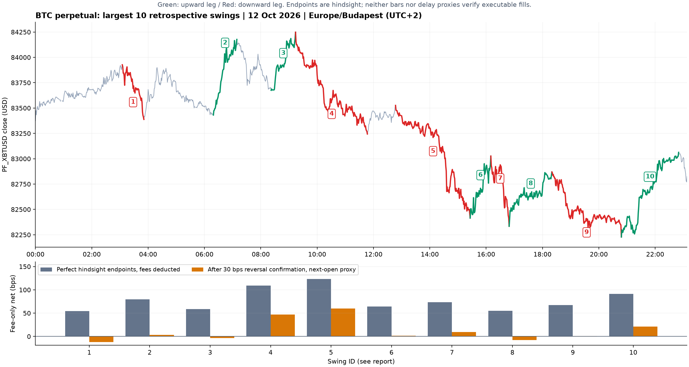

# 2026-10-12 BTC 日内波段复盘

今天确实存在多段明显的上涨和下跌。下面是按已观察到的分钟收盘价整理的事后进出位置，用于定位值得进一步研究的行情片段；这些极值不是当时可预知的信号。

时间统一为 **Europe/Budapest，UTC+2**。行情为 Kraken Futures **PF_XBTUSD**，快照覆盖本地时间 **00:00–23:08**，共 **1,383** 根已完成分钟 K 线。表中时间是 K 线起始分钟，价格为该分钟收盘价，下一分钟才知道；例如 09:14 行的价格需到约 09:15 才可观察。价格单位为美元。

## 主要进出位置

以下展示幅度最大的 10 段完整且已确认的波段，按时间排序。排除以日界线为起点的片段。箭头表示持仓方向；空头收益按价格下降计算。扣费幅度按一单位线性合约、无杠杆、入场名义金额归一化，不是账户收益率。

| 编号 | 方向 | 事后入场分钟 | 入场参考价 | 事后出场分钟 | 出场参考价 | 毛幅度 | 仅扣手续费 | 持有分钟 |
|---|---|---|---:|---|---:|---:|---:|---:|
| 1 | ↓ 做空 | 03:05 | 83,927 | 03:51 | 83,388 | 64.22 bps | 54.25 bps | 46 |
| 2 | ↑ 做多 | 06:19 | 83,431 | 07:09 | 84,177 | 89.42 bps | 79.37 bps | 50 |
| 3 | ↑ 做多 | 08:22 | 83,675 | 09:14 | 84,248 | 68.48 bps | 58.44 bps | 52 |
| 4 | ↓ 做空 | 09:14 | 84,248 | 11:47 | 83,244 | 119.17 bps | 109.23 bps | 153 |
| 5 | ↓ 做空 | 12:47 | 83,526 | 15:26 | 82,415 | 133.01 bps | 123.08 bps | 159 |
| 6 | ↑ 做多 | 15:26 | 82,415 | 16:10 | 83,026 | 74.14 bps | 64.10 bps | 44 |
| 7 | ↓ 做空 | 16:10 | 83,026 | 16:49 | 82,334 | 83.35 bps | 73.39 bps | 39 |
| 8 | ↑ 做多 | 16:49 | 82,334 | 18:20 | 82,869 | 64.98 bps | 54.95 bps | 91 |
| 9 | ↓ 做空 | 18:20 | 82,869 | 20:48 | 82,228 | 77.35 bps | 67.39 bps | 148 |
| 10 | ↑ 做多 | 20:48 | 82,228 | 22:50 | 83,063 | 101.55 bps | 91.50 bps | 122 |

其中两段下跌最突出：**09:14→11:47** 和 **12:47→15:26**；最显著的晚间反弹是 **20:48→22:50**。表中的完美进出点依赖后来的反转才确认为极值。

手续费取本次只读 `/price` 快照中的 taker 每边 0.05%。往返费用按入场与出场实际名义价格分别计算，约为 10 bps，而非固定从每笔恰好减 10。未计价差、冲击、资金费率、延迟和实际可成交数量，也未假设 maker 成交。1 bps = 0.01%，100 bps = 1%。

## 等到反转确认会怎样

为了呈现识别延迟，另外回放同一批事后选定片段：从局部极值反向走过 30 个对数 bps 后，才能确认这个极值，参考入场或离场价取确认收盘后的下一分钟开盘。没有紧邻下一分钟数据时不构造成交。这个回放仍使用事后选出的片段，**不能当成已验证的交易策略**；下一分钟开盘价也不是实际 bid/ask 成交证明。

| 编号 | 确认后参考入场分钟 | 参考入场价 | 确认后参考出场分钟 | 参考出场价 | 仅扣手续费幅度 |
|---|---|---:|---|---:|---:|
| 1 | 03:31 | 83,664 | 04:01 | 83,683 | -12.27 bps |
| 2 | 06:35 | 83,715 | 07:31 | 83,828 | 3.49 bps |
| 3 | 08:51 | 83,937 | 09:31 | 83,991 | -3.57 bps |
| 4 | 09:31 | 83,991 | 12:47 | 83,510 | 47.30 bps |
| 5 | 13:41 | 83,250 | 15:40 | 82,668 | 59.94 bps |
| 6 | 15:40 | 82,668 | 16:18 | 82,763 | 1.49 bps |
| 7 | 16:18 | 82,763 | 17:07 | 82,600 | 9.70 bps |
| 8 | 17:07 | 82,600 | 18:50 | 82,617 | -7.94 bps |
| 9 | 18:50 | 82,617 | 21:26 | 82,527 | 0.90 bps |
| 10 | 21:26 | 82,527 | 23:07 | 82,783 | 21.00 bps |

例如，12:47→15:26 的理想空头波段在 13:40 收盘后确认，参考 13:41 的 83,250 入场，15:39 收盘后确认低点、参考 15:40 的 82,668 出场，仅扣手续费后约 **59.94 bps**。09:14→11:47 的空头，在同类确认延迟下约剩 **47.30 bps**。也有多段变为负数，说明“事后有大波动”与“当时可以识别并赚钱”之间仍有距离。

这与上一轮一分钟条件均值模型未优于零预测并不矛盾：大幅实现波动可以存在于低可预测性的价格路径中，长时域波段也不同于下一分钟预测。需要进一步检查的是入场前已有的信息能否区分后来上涨、下跌及没有走出来的片段，不能只研究成功波段。

## 图表

绿色为上涨片段，红色为下跌片段，编号与表一致。下图比较完美极值进出与等反转确认后的参考进出。

## 描述方法及数据缺口

波段使用 30 对数 bps 的方向反转尺度作一致的图形分段，保留每个方向上的观察极值，以后来的反转确认端点。这个尺度只用于事后定位，不是调优得到的买卖规则。全天得到 17 个已完成片段；20、50 bps 尺度分别得到 29、12 个，分段数量依赖观察尺度，端点不是唯一答案。这里只选毛幅度最大的 10 段，不用它们计算策略总收益。原始 JSON 保留全部 17 段及尚未确认结束的尾段。

当天缺少 6 根分钟 K 线：**00:51、00:55、00:56、05:40、12:59、22:38**。缺口不填补、不虚构路径。第 5、10 段各跨一个缺失分钟，其端点为已观察收盘价的极值，不能排除缺失分钟里存在更高或更低的价格。没有把 K 线内最高价与最低价拼成无法确定先后次序的理想交易。

这次是只读复盘，没有下单，没有改变交易员或经理，没有访问办公室独立的长期留出评估窗口。

## 可复现资料

- [数据与逐段计算 JSON](../../spikes/08-intraday-opportunities/opportunities.json)
- [主要波段 CSV](../../spikes/08-intraday-opportunities/opportunities.csv)
- [分析脚本](../../spikes/08-intraday-opportunities/analyze.py)
- [冻结分钟行情](../../spikes/08-intraday-opportunities/data/raw_context.json)
- [手续费快照](../../spikes/08-intraday-opportunities/data/price_snapshot.json)

数据原文 SHA-256：`46f9bd375e5dd0ede8c5337c533b2c58a588dd327abbbb2dacbb34c4b6063386`。重新生成需要 Python 和 matplotlib：`python3 spikes/08-intraday-opportunities/analyze.py`。
